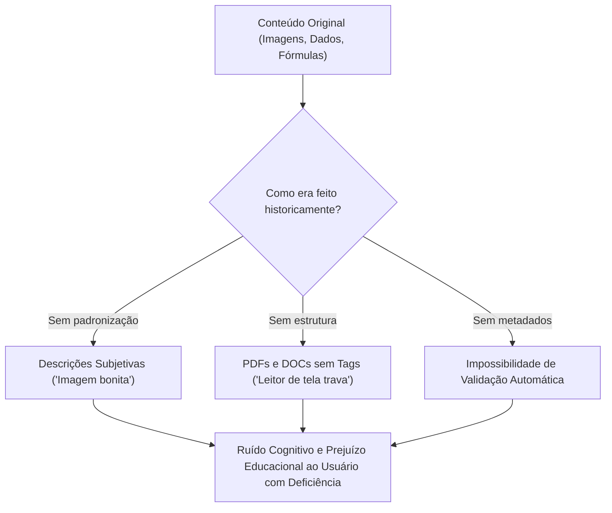
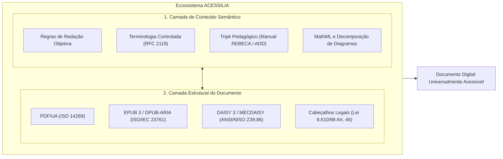
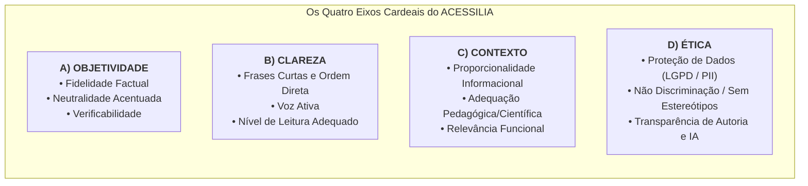
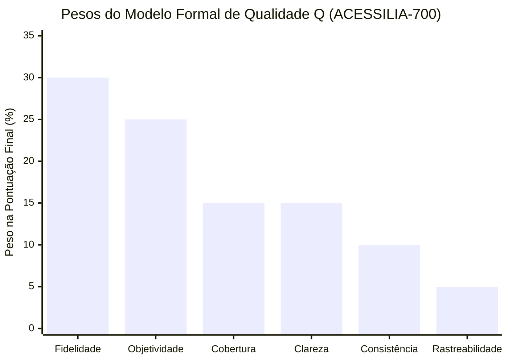
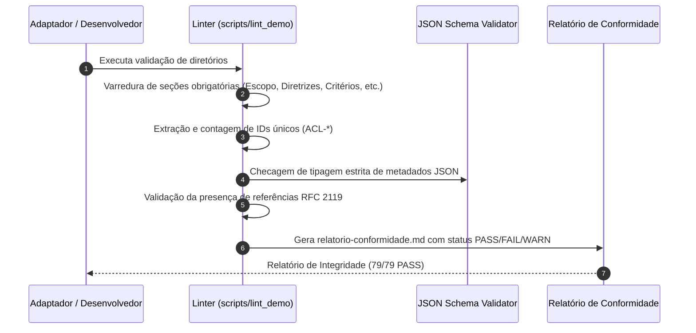

<div align="center">
  
</div>

<details>
<summary><strong>Audiodescrição / Texto Alternativo da Logomarca ACESSILIA</strong></summary>

> *Logotipo com o nome "acessilia" em destaque na parte superior. Acima do nome, um círculo em tons de azul mistura duas imagens: à esquerda, um documento com bordas arredondadas contendo um ícone de foto no topo e uma grade tipo planilha na parte inferior; à direita, o perfil de uma cabeça humana voltado para a direita, também em azul. Três linhas curvas saem da região da boca, sugerindo fala ou som. À esquerda do documento, fileiras de pequenos pontos circulares em degradê de azul dão sensação de movimento ou textura digital. Abaixo do símbolo está a palavra "acessilia": "acess" em azul escuro e "ilia" em verde-água. Sob o nome, uma linha fina azul com um ponto em cada ponta. Mais abaixo, o texto "TRANSFORMANDO DOCUMENTOS. GERANDO ACESSIBILIDADE." No rodapé aparecem quatro ícones em azul escuro, separados por pequenos traços: um quadrado com seis pontos em relevo (símbolo que lembra braille), um alto-falante, um olho estilizado e um retângulo que representa um documento ou página.*

</details>

# Relatório Técnico Geral: Padrão Normativo ACESSILIA
## Sistema Brasileiro de Normas de Acessibilidade Digital e Descrição Semântica

> **Status do Documento**: Documento de Trabalho Dinâmico (Suscetível a Atualizações Contínuas)  
> **Versão Base**: 1.1.0 (Com expansões de 2026)  
> **Data de Emissão**: 16 de Outubro de 2026  
> **Comitê Responsável**: Equipe Técnica e Editorial ACESSILIA ([A11yDevs](https://github.com/A11yDevs/normas-acessilia))  
> **Harmonização Normativa**: RFC 2119/8174, WCAG 2.2, ABNT NBR 17225:2025, ISO 14289 (PDF/UA), ISO/IEC 23761 (EPUB), ANSI/NISO Z39.86 (DAISY) e Manual REBECA 2025.

> [!IMPORTANT]
> **Aviso Importante sobre a Natureza deste Documento**:  
> Este **não é um relatório final ou definitivo**; trata-se de um documento de trabalho dinâmico que **ainda pode sofrer alterações, complementações e refinamentos contínuos**.  
> O seu objetivo é servir como um **relatório consolidado geral** que organiza e resume os conceitos do padrão em linguagem acessível e didática para proporcionar uma **fácil compreensão** por parte de qualquer leitor, educador, gestor ou profissional.  
> As especificações técnicas integrais, os esquemas JSON de validação, os perfis formais de conformidade, os critérios normativos detalhados e as suítes de testes estão em constante evolução e desenvolvimento no **repositório oficial de pesquisa e estruturação do Padrão ACESSILIA de Qualidade e Conformidade**:  
> 👉 **Repositório Oficial**: [https://github.com/A11yDevs/normas-acessilia](https://github.com/A11yDevs/normas-acessilia)

---

## Sumário Executivo

1. [Apresentação e Visão Geral](#1-apresentação-e-visão-geral)
   - 1.1 O que é o ACESSILIA (em linguagem simples e técnica)
   - 1.2 O Problema Histórico da Acessibilidade Digital
   - 1.3 A Solução ACESSILIA: Conteúdo + Contêiner
2. [Arquitetura Geral do Padrão](#2-arquitetura-geral-do-padrão)
   - 2.1 A Estrutura Modular das Famílias (100 a 800)
   - 2.2 Rastreabilidade e Identificadores Permanentes
3. [Princípios Fundamentais e Filosofia Normativa (ACESSILIA-100)](#3-princípios-fundamentais-e-filosofia-normativa-acessilia-100)
   - 3.1 Os Quatro Eixos Cardeais: Objetividade, Clareza, Contexto e Ética
   - 3.2 Hierarquia de Resolução de Conflitos
   - 3.3 Requisitos para Inteligência Artificial
4. [Detalhamento Técnico das Famílias de Conteúdo](#4-detalhamento-técnico-das-famílias-de-conteúdo)
   - 4.1 Família 200 — Imagens Estáticas
   - 4.2 Família 300 — Gráficos, Tabelas e Diagramas (STEM & DIAGRAM Center)
   - 4.3 Família 400 — Conteúdo Científico, Fórmulas e MathML
   - 4.4 Família 500 — Conteúdo Didático e Audiodescrição Pedagógica (ADD)
   - 4.5 Família 600 — Mídias Audiovisuais, DAISY e Transcrições
   - 4.6 Família 700 — Métricas, Modelo de Qualidade e Validação
   - 4.7 Família 800 — Perfis de Conformidade e Formatos Digitais
5. [Acessibilidade de Documentos e Formatos Estruturais](#5-acessibilidade-de-documentos-e-formatos-estruturais)
   - 5.1 O Manual REBECA de Padronização Documental (Amparo na Lei de Direitos Autorais nº 9.610/98)
   - 5.2 PDF/UA-1 e PDF/UA-2 (ISO 14289 e Matterhorn Protocol)
   - 5.3 Publicações EPUB 3 e DPUB-ARIA (ISO/IEC 23761)
   - 5.4 Áudio e Texto Sincronizado (DAISY / MECDAISY)
6. [Mecanismos de Validação Automatizada e Auditoria Humana](#6-mecanismos-de-validação-automatizada-e-auditoria-humana)
   - 6.1 Como funciona o `acessilia-lint`
   - 6.2 O Esquema JSON Schema (`schemas/acessilia.schema.json`)
   - 6.3 O Papel da Revisão Humana
7. [Matriz de Correspondência com Normas Nacionais e Internacionais](#7-matriz-de-correspondência-com-normas-nacionais-e-internacionais)
8. [Marco Jurídico e Políticas Públicas de Acessibilidade](#8-marco-jurídico-e-políticas-públicas-de-acessibilidade)
   - 8.1 Lei Brasileira de Inclusão (LBI nº 13.146/2015 — Art. 63 e Art. 68)
   - 8.2 Lei de Direitos Autorais (Lei nº 9.610/1998 — Art. 46) e o Manual REBECA
   - 8.3 Decreto Federal nº 5.296/2004 e o Modelo de Acessibilidade em Governo Eletrônico (e-MAG)
   - 8.4 Tratado de Marraquexe (Decreto Presidencial nº 9.522/2018)
9. [Glossário Terminológico e Léxico Técnico Acessível](#9-glossário-terminológico-e-léxico-técnico-acessível)
10. [Considerações Finais e Próximos Passos](#10-considerações-finais-e-próximos-passos)

---

## 1. Apresentação e Visão Geral

### 1.1 O que é o ACESSILIA (em linguagem simples e técnica)

#### Em Linguagem Simples:
Imagine que uma pessoa cega ou com baixa visão está lendo um livro didático no computador usando um programa que lê a tela em voz alta (leitor de tela). Quando esse leitor de tela chega a uma foto, a um gráfico de economia ou a uma fórmula de química, ele muitas vezes fica mudo ou diz apenas a palavra *"imagem"* ou o código *"imagem_123.jpg"*. Isso acontece porque o autor não colocou uma descrição textual que explique aquilo com clareza. 

Por outro lado, quando alguém tenta descrever, muitas vezes comete erros graves: inventa coisas que não estão lá, expressa opiniões pessoais (como dizer *"linda pintura"*), ou descreve de forma tão confusa que o estudante não consegue entender nada. 

O **ACESSILIA** é um **manual técnico e um conjunto de regras oficiais brasileiras** que ensina exatamente **como descrever qualquer tipo de imagem, gráfico, vídeo ou documento de forma clara, honesta, direta e sem enrolação**, além de garantir que o arquivo (seja ele um PDF, um livro digital ou um texto do Word) esteja construído de modo que os leitores de tela consigam lê-lo sem travar.

#### Em Linguagem Técnica:
O **ACESSILIA** (*Sistema Brasileiro de Normas de Acessibilidade Digital e Descrição Semântica*) é uma especificação técnica formal orientada a regras computacionalmente verificáveis e auditáveis. Ele padroniza:
1. **A semântica textual descritiva** (linguagem controlada, conformidade com a RFC 2119, níveis de leitura objetivos e ausência de inferências subjetivas);
2. **A representação em metadados estruturados** (JSON Schema draft-07 e XSD com tipagem estrita para integração com APIs, pipelines editoriais e inteligências artificiais);
3. **A conformidade estrutural de contêineres e documentos digitais**, alinhando-se a normas ISO de publicação eletrônica (ISO 14289 PDF/UA, ISO/IEC 23761 EPUB A11y, ANSI/NISO Z39.86 DAISY, e a recente ABNT NBR 17225:2025).

---

### 1.2 O Problema Histórico da Acessibilidade Digital

Historicamente, as iniciativas de acessibilidade digital concentraram-se na interface do usuário (ex.: se o botão tem contraste suficiente ou se o foco do teclado funciona no site). No entanto, o **conteúdo semântico complexo** e a **arquitetura de arquivos digitais** permaneceram um terreno despadronizado:



As principais falhas encontradas no mercado eram:
1. **Subjetividade e Alucinação**: Descritores interpretando sentimentos, adivinhando identidades ou dando juízos estéticos;
2. **Falta de Padronização para Educação**: Descrições de provas escolares que acidentalmente davam a resposta do exercício ao estudante cego;
3. **Incompatibilidade Tecnológica**: Documentos PDF gerados como meras "fotografias de páginas", impedindo a leitura linear;
4. **Ausência de Metadados Rastreáveis**: Nenhuma informação sobre quem adaptou o documento, se houve uso de IA ou qual o amparo legal dos direitos autorais.

---

### 1.3 A Solução ACESSILIA: Conteúdo + Contêiner

O diferencial do padrão ACESSILIA reside na sua abordagem integrada de **dupla camada**:



---

## 2. Arquitetura Geral do Padrão

### 2.1 A Estrutura Modular das Famílias (100 a 800)

O padrão foi construído de forma modularizada, dividido em **Famílias temáticas**. Essa separação permite que um projeto adote apenas a família necessária (ex.: um banco de imagens utiliza a Família 200, enquanto uma editora universitária utiliza as Famílias 400, 500 e 800).

```
ACESSILIA-Base (Arquitetura central, manifesto e versionamento semântico)
    │
    ├── ACESSILIA-100: Terminologia, Princípios Fundamentais, Ética e Governança de IA
    │
    ├── ACESSILIA-200: Imagens Estáticas (Fotografias, Pinturas, Capturas de Tela, Desenhos)
    ├── ACESSILIA-300: Gráficos de Dados, Tabelas Estatísticas e Diagramas Estruturados (STEM)
    ├── ACESSILIA-400: Conteúdo Acadêmico, Científico, Artigos, Teses e Fórmulas (MathML)
    ├── ACESSILIA-500: Conteúdo Didático, Livros Escolares e Audiodescrição Didática (ADD)
    ├── ACESSILIA-600: Conteúdo Audiovisual, Vídeos, Podcasts, Animações e Áudio Sincronizado
    │
    ├── ACESSILIA-700: Métricas de Qualidade, Modelo Matemático e Validação de Conformidade
    └── ACESSILIA-800: Perfis de Aplicação (PDF/UA, EPUB 3, DAISY, REBECA) e Extensibilidade
```

### 2.2 Rastreabilidade e Identificadores Permanentes

Cada regra, diretriz, técnica e perfil dentro do ACESSILIA possui um código permanente e imutável no formato:

$$\mathbf{ACL\text{-}\langle FAM\acute{I}LIA\rangle\text{-}\langle CATEGORIA\rangle\text{-}\langle N\acute{U}MERO\rangle}$$

- **Critérios da Família**: Ex.: `ACL-200-IMG-001` (descrição observável de imagem estática), `ACL-300-GRF-001` (fonte de dados em gráfico);
- **Perfis de Formato (Família 800)**: Ex.: `ACL-800-PRF-001` (Livro Digital), `ACL-800-PRF-007` (Padrão REBECA Acadêmico), `ACL-800-PRF-008` (PDF/UA);
- **Critérios de Validação de Perfis**: Ex.: `ACL-800-CRT-001` a `ACL-800-CRT-005`.

---

## 3. Princípios Fundamentais e Filosofia Normativa (ACESSILIA-100)

O documento [ACESSILIA-100.md](file:///c:/Users/fjhon/normas-acessilia/ACESSILIA-100.md) é o alicerce moral, linguístico e técnico de todo o sistema.

### 3.1 Os Quatro Eixos Cardeais

Inspirado nas diretrizes do W3C e nas pesquisas acadêmicas do consórcio universitário brasileiro (Manual REBECA, 2025), o ACESSILIA assenta-se sobre 4 eixos principais:



### 3.2 Hierarquia de Resolução de Conflitos

Em situações complexas onde um princípio parece entrar em rota de colisão com outro (por exemplo: fornecer contexto suficiente sem se tornar prolixo ou opinativo), o ACESSILIA estipula uma **precedência matemática rígida**:

$$\mathbf{Fidelidade \succ Neutralidade \succ Clareza \succ Contextualiza\text{ç}\tilde{a}o \succ Estilo}$$

1. **Fidelidade (Nível Supremo)**: Jamais invente ou afirme nada que não seja fisicamente visível ou comprovável no documento.
2. **Neutralidade**: Não aplique termos emotivos ou juízos morais.
3. **Clareza**: Prefira a estrutura frasal mais compreensível.
4. **Contextualização**: Ajuste o foco ao objetivo didático ou comunicativo.
5. **Estilo**: Decisões cosméticas de redação ficam sempre em último lugar.

### 3.3 Requisitos para Inteligência Artificial (§7)

Com a crescente utilização de Grandes Modelos de Linguagem (LLMs) e Visão Computacional (VLM), o ACESSILIA-100 estabelece requisitos compulsórios:
- **Declaração de Transparência**: OBRIGATÓRIO informar na fonte quando uma descrição foi gerada com auxílio de IA (ex.: *"Fonte da descrição: Elaborada com auxílio de IA [Modelo] e revisada por [Especialista]"*);
- **Registro de Incertezas**: Elementos visuais ambíguos, ilegíveis ou ocultos não podem ser inventados (alucinação zero); devem ser declarados no campo estruturado `uncertainty`;
- **Salvaguarda de Direitos Autorais**: Em respeito à Lei nº 9.610/1998, documentos protegidos e restritos não devem ser enviados para servidores de terceiros ou IAs públicas sem os devidos acordos de confidencialidade institucional.

---

## 4. Detalhamento Técnico das Famílias de Conteúdo

### 4.1 Família 200 — Imagens Estáticas
- **Foco**: Fotografias, pinturas, desenhos artísticos e capturas de tela (*screenshots*).
- **Diretrizes Chave**:
  - `ACL-200-IMG-001`: Relato estritamente observável com verbos concretos;
  - `ACL-200-IMG-002`: Proibição de inferência de sentimentos subjetivos (ex.: em vez de *"mulher feliz"*, use *"mulher sorri amplamente olhando para frente"*);
  - `ACL-200-IMG-004`: Ordem espacial consistente (de cima para baixo, da esquerda para a direita, do plano geral aos detalhes centrais);
  - `ACL-200-IMG-005` e `007`: Alertas de privacidade (`privacyNotice`) para dados pessoais e checagem de contraste de cores.

### 4.2 Família 300 — Gráficos, Tabelas e Diagramas (STEM & DIAGRAM Center)
- **Foco**: Representação visual de dados quantitativos, gráficos de barras, linhas, mapas conceituais e fluxogramas.
- **Inovações Incorporadas**:
  - **Adoção das diretrizes do DIAGRAM Center**: Uso da **Two-Part Strategy** (uma descrição curta no `alt` apontando para onde está a explicação detalhada);
  - **Técnica `T-300-01`**: Obrigatoriedade de fornecer uma **tabela equivalente adjacente** para qualquer gráfico complexo; leitores de tela navegam com muito mais agilidade em células de tabelas do que ouvindo parágrafos longos com dezenas de números;
  - **Técnica `T-300-03`**: Decomposição estrutural de fluxogramas em listas aninhadas ou relações relacionais (Origem $\rightarrow$ Ação $\rightarrow$ Destino).

### 4.3 Família 400 — Conteúdo Científico, Fórmulas e MathML
- **Foco**: Artigos acadêmicos, teses, papers e notação científica.
- **Inovações Incorporadas**:
  - **MathML 4.0 e LaTeX Acessível (`T-400-04` e `F-400-01`)**: Fórmulas e equações científicas **NÃO DEVEM** ser inseridas apenas como figuras (.png ou .jpg). Devem ser codificadas primariamente em **MathML semântico**, permitindo que o leitor de tela navegue por frações, raízes e potências elemento por elemento, ou gere braille matemático digital (Nemeth Code / BANA);
  - **Distinção Rígida de Autoria (`T-400-03`)**: Separação clara entre quem criou a figura original (`Fonte da imagem:`) e quem fez o trabalho de acessibilidade (`Fonte da descrição:`).

### 4.4 Família 500 — Conteúdo Didático e Audiodescrição Pedagógica (ADD)
- **Foco**: Livros escolares, apostilas, exames de vestibular, provas e atividades pedagógicas.
- **Inovações Incorporadas**:
  - **O Tripé da ADD (Manual REBECA / Tese de Vergara-Nunes, 2016)**:
    1. **Receptor**: Nível cognitivo e escolaridade do estudante;
    2. **Contexto**: A finalidade do exercício ou conteúdo dentro da disciplina;
    3. **Imagem**: Complexidade e significado visual.
  - **Regra da Não-Revelação da Resposta (`F-500-01`)**: A audiodescrição pedagógica jamais pode entregar a solução de uma questão avaliativa (ex.: em uma prova de física sobre plano inclinado, a descrição deve relatar o bloco na rampa e os ângulos mostrados, mas não dizer qual vetor anula a força de atrito);
  - **Nota do Adaptador Padronizada (`T-500-01`)**: Quando a descrição visual pura anular o objetivo do teste (como uma questão de interpretação visual subjetiva), adota-se a fórmula padrão do MEC:
    > *"Nota do digitalizador: Procure o auxílio do professor ou ledor para a interpretação desta questão."*

### 4.5 Família 600 — Mídias Audiovisuais, DAISY e Transcrições
- **Foco**: Videoaulas, podcasts, animações, debates gravados e materiais sonoros.
- **Diretrizes Chave**:
  - Legendas sincronizadas completas (formato WebVTT ou SRT);
  - Audiodescrição inserida nos intervalos naturais de respiração e pausas de fala, sem sobrepor as palavras do instrutor (`T-600-02`);
  - Transcrição expandida completa para usuários com surdocegueira (`T-600-03`).

### 4.6 Família 700 — Métricas, Modelo de Qualidade e Validação
- **Foco**: Auditoria de qualidade e certificação técnica de descrições e documentos.
- **Modelo de Qualidade em 6 Dimensões**:



A **Pontuação Final de Qualidade ($Q$)** é dada pela expressão ponderada:
$$Q = 0{,}30 \times \text{Fidelidade} + 0{,}25 \times \text{Objetividade} + 0{,}15 \times \text{Cobertura} + 0{,}15 \times \text{Clareza} + 0{,}10 \times \text{Consistência} + 0{,}05 \times \text{Rastreabilidade}$$

- **Níveis de Conquista**:
  - **ACESSILIA-A**: $Q \ge 80$ e nenhum critério obrigatório violado;
  - **ACESSILIA-AA**: $Q \ge 90$ e atendimento aos critérios de alta prioridade;
  - **ACESSILIA-AAA**: $Q \ge 95$ e excelência total.

### 4.7 Família 800 — Perfis de Conformidade e Formatos Digitais
A Família 800 atua como o ponto de encontro entre o conteúdo e os formatos de arquivo de distribuição. Ela define perfis formais para cenários de mercado e pesquisa:
- `ACL-800-PRF-001`: Livro Digital Geral
- `ACL-800-PRF-002`: Fotografia
- `ACL-800-PRF-003`: Notação Matemática
- `ACL-800-PRF-004`: Gráficos Científicos
- `ACL-800-PRF-005`: Captura de Tela (UI/UX)
- `ACL-800-PRF-006`: Conteúdo STEM Completo
- `ACL-800-PRF-007`: **Documento Acadêmico (Padrão REBECA)**
- `ACL-800-PRF-008`: **Documento PDF/UA Universal (ISO 14289)**
- `ACL-800-PRF-009`: **Publicação EPUB Acessível (ISO/IEC 23761)**
- `ACL-800-PRF-010`: **Áudio Digital e Texto Sincronizado (DAISY / MECDAISY)**

---

## 5. Acessibilidade de Documentos e Formatos Estruturais

A grande expansão contemporânea do ACESSILIA contempla como os arquivos são gravados e gerados no meio acadêmico e editorial.

### 5.1 O Manual REBECA de Padronização Documental (Amparo na Lei de Direitos Autorais nº 9.610/98)

> **Nota Explicativa**: O **Padrão REBECA não é uma lei**, mas sim um **manual técnico de padronização prática e acadêmica** (*Manual de Padronização para Adaptação de Documentos em Formato Digital Acessível*, 2025), desenvolvido pela Rede REBECA (Rede Brasileira de Estudos e Conteúdos Adaptados, articulada por universidades como UnB, UFRN e UFC). A base jurídica e legal de amparo que ele e o ACESSILIA invocam é a **Lei Federal de Direitos Autorais (Lei nº 9.610/1998)**.

O perfil `ACL-800-PRF-007` do ACESSILIA absorve as diretrizes operacionais do Manual REBECA:

1. **Cabeçalho de Amparo Legal Obrigatório (Lei nº 9.610/1998)**:  
   Todo documento adaptado para formato acessível deve abrir com uma nota formal de salvaguarda dos direitos autorais amparada pelo **Artigo 46, Inciso I, alínea 'd' da Lei Federal nº 9.610/1998** (com redação harmonizada pelo Tratado de Marraquexe e Lei Brasileira de Inclusão):
   > *"A reprodução de obras literárias, artísticas ou científicas, para uso exclusivo de pessoas com deficiência visual ou com outra incapacidade de ter acesso ao texto impresso, sem fins lucrativos, é permitida por lei."*
   
2. **Marcadores Auditivos de Início e Fim**:  
   Sintetizadores de voz de leitores de tela precisam saber exatamente quando uma imagem começa a ser descrita e quando a narrativa do autor do livro recomeça. Por isso, a REBECA e o ACESSILIA tornam obrigatórios os marcadores:
   - Para figuras: `[Início da descrição]` ... texto da AD ... `[Fim da descrição]`
   - Para citações diretas longas: `[Início da citação]` ... texto citado ... `[Final da citação]`

3. **Nomenclatura Padronizada de Arquivos**:  
   Para facilitar a localização e catalogação em acervos e repositórios institucionais:
   $$\mathbf{[SobrenomeAutor]\_[PrimeiraPalavraTitulo]\_[RADICAL]}$$
   Onde o radical indica o gênero documental: `LIVR` (Livro), `ART` (Artigo), `CAP` (Capítulo), `MONOG` (Monografia), `DISSERT` (Dissertação), `TES` (Tese), `SLIDE` (Apresentação), `TCC`, `PART` (Partitura), `VID` (Vídeo) e `AUD` (Áudio).

---

### 5.2 PDF/UA-1 e PDF/UA-2 (ISO 14289 e Matterhorn Protocol)

O formato PDF é amplamente utilizado em documentos oficiais e órgãos governamentais, mas se não for estruturado de acordo com a norma **PDF/UA (ISO 14289)**, torna-se uma barreira intransponível para quem utiliza leitores de tela.

O ACESSILIA incorpora a validação baseada no **Matterhorn Protocol**:
- **Árvore de Tags Completa**: Todos os títulos devem usar `<H1>`, `<H2>`, os parágrafos `<P>`, as listas `<L>` e `<LI>`;
- **Ordem Lógica de Leitura**: O fluxo da leitura assistiva deve seguir a ordem semântica natural, não a posição das coordenadas gráficas na página;
- **Artefatos vs. Conteúdo**: Elementos decorativos (linhas cosméticas, marcas d'água de cabeçalho) devem ser marcados explicitamente como *Artifacts*, evitando que o leitor de tela leia o número da página no meio de uma frase.

---

### 5.3 Publicações EPUB 3 e DPUB-ARIA (ISO/IEC 23761)

O **EPUB 3** é o padrão moderno de publicação eletrônica aberta mantido pelo W3C. Sob o perfil `ACL-800-PRF-009`, o ACESSILIA exige:
- **Metadados Schema.org/Accessibility**:
  - `accessMode`: modos sensoriais requeridos (ex.: `textual`, `visual`);
  - `accessibilityFeature`: recursos inclusos (ex.: `alternativeText`, `readingOrder`, `structuralNavigation`, `tableOfContents`);
  - `accessibilitySummary`: resumo explicativo em linguagem natural sobre o nível de acessibilidade do livro.
- **DPUB-ARIA 1.1**: Marcação semântica com papéis editoriais nos elementos HTML (`role="doc-chapter"`, `role="doc-footnote"`, etc.).

---

### 5.4 Áudio e Texto Sincronizado (DAISY / MECDAISY)

O padrão **DAISY (Digital Accessible Information System)** e a sua implementação oficial pelo Ministério da Educação (**MECDAISY**, amparada pela Nota Técnica nº 21/MEC/SECADI/DPEE):
- Utiliza a linguagem **SMIL** para sincronizar milissegundo a milissegundo a fala de áudio gravada (ou voz sintetizada) com os caracteres do texto;
- Permite que estudantes com deficiência visual ou dislexia naveguem por parágrafos, frases e páginas do livro didático com total precisão temporal.

---

## 6. Mecanismos de Validação Automatizada e Auditoria Humana

### 6.1 Como funciona o `acessilia-lint`

O repositório do ACESSILIA dispõe de uma suíte de automação em PowerShell (`scripts/lint_demo.ps1`) e Bash (`scripts/lint_demo.sh`). O linter desempenha 4 etapas de checagem:



Atualmente, o repositório mantém **100% de aprovação (79 checks PASS)** em todas as suas 7 famílias operacionais.

### 6.2 O Esquema JSON Schema (`schemas/acessilia.schema.json`)

O arquivo [acessilia.schema.json](file:///c:/Users/fjhon/normas-acessilia/schemas/acessilia.schema.json) contém as regras computacionais estritas:
- **Campos Fundamentais Obrigatórios**: `id`, `description`, `language`, `license`, `standard`, `date` e `reviewStatus`;
- **Regras Condicionais (`allOf` / `if` / `then`)**: Se `familyId == 300`, exige campos de gráficos (`chartType`, `source`); se `familyId == 500`, exige contexto educacional (`educationalContext`, `learningObjectives`);
- **Campos de Documentos REBECA e Formatos**: Suporta oficialmente `legalNotice`, `adaptingInstitution`, `descriptionDelimiters` e `namingConvention`.

---

## 7. Matriz de Correspondência com Normas Nacionais e Internacionais

Esta tabela consolida como o ACESSILIA atua como uma ponte integradora entre os maiores padrões do mundo e do Brasil:

| Padrão / Norma | Organização Responsável | Escopo e Abrangência | Famílias ACESSILIA Impactadas |
|---|---|---|---|
| **ABNT NBR 17225:2025** | ABNT / CeWeb.br / LBI Art. 63 | Norma brasileira de acessibilidade em aplicações e conteúdo web | 100, 200, 300, 400, 500, 600, 700 |
| **Manual REBECA 2025** | UnB / UFRN / UFC / SECADI | Padronização universitária de audiodescrição e documentos acadêmicos | 100, 400, 500, 600, 800 |
| **WCAG 2.2 / ISO/IEC 40500** | W3C / ISO | Diretrizes globais de acessibilidade para a web | Todas (200 a 800) |
| **PDF/UA-1 e 2 (ISO 14289)** | ISO / PDF Association | Estrutura de tags, linearização e acessibilidade universal de PDFs | 200, 300, 400, 500, 700, 800 |
| **EPUB A11y 1.1 (ISO/IEC 23761)** | W3C Publishing / ISO | Livros e publicações digitais abertas com metadados de acessibilidade | 200, 300, 400, 500, 700, 800 |
| **DAISY 3 / MECDAISY** | DAISY Consortium / MEC | Áudio digital sincronizado (SMIL) para livros didáticos | 500, 600, 700, 800 |
| **DIAGRAM Center** | Benetech / US Dept of Education | Diretrizes de imagens complexas, gráficos de dados e ciência (STEM) | 200, 300, 400, 500 |
| **BANA Tactile & Nemeth** | Braille Authority of North America | Notação matemática acessível e diretrizes para diagramas táteis | 300, 400, 500 |
| **Matterhorn Protocol 1.1** | PDF Association | Checklist e testes de validação técnica para PDF/UA | 700, 800 |
| **ISO 9241-171** | ISO | Ergonomia do software e acessibilidade em sistemas eletrônicos | 200, 300, 700 |
| **ISO/IEC Guia 71** | ISO / IEC / ABNT | Princípios de integração de acessibilidade no desenvolvimento de normas | 100, 700, 800 |

---

---

## 8. Marco Jurídico e Políticas Públicas de Acessibilidade

O padrão **ACESSILIA** não opera em um vácuo teórico; ele fundamenta-se e dá suporte direto ao cumprimento das principais legislações, decretos federais e tratados internacionais de direitos humanos vigentes no Brasil. Compreender essa ancoragem jurídica é vital para gestores públicos, instituições educacionais, editoras e empresas de tecnologia.

### 8.1 Lei Brasileira de Inclusão da Pessoa com Deficiência (LBI — Lei nº 13.146/2015)

A LBI institui o Estatuto da Pessoa com Deficiência e estabelece a acessibilidade como direito fundamental indisponível:
- **Artigo 63 (Acessibilidade Digital Obrigatória)**: Determina que é obrigatória a acessibilidade nos sítios da internet mantidos por empresas com sede ou representação comercial no país ou por órgãos de governo, para uso da pessoa com deficiência, garantindo-lhe acesso às informações disponíveis, conforme as melhores práticas e diretrizes de acessibilidade adotadas internacionalmente (harmonizadas no Brasil pela ABNT NBR 17225:2025 e WCAG 2.2).
- **Artigo 68 (Livros e Materiais Didáticos em Formatos Acessíveis)**: Estabelece que o poder público deve adotar mecanismos de incentivo à produção, à edição, à difusão e à distribuição de livros em formatos acessíveis, inclusive em publicações digitais, para pessoas com deficiência. Assegura também que as editoras são obrigadas a disponibilizar, sob demanda, exemplares em formato acessível. O ACESSILIA-800 e a adoção do EPUB 3 com metadados de acessibilidade fornecem o instrumental técnico para cumprir o Art. 68 de forma padronizada.

### 8.2 Lei de Direitos Autorais (Lei Federal nº 9.610/1998, Art. 46) e o Manual REBECA

Uma das grandes barreiras históricas à adaptação de livros e artigos científicos para pessoas com deficiência era o receio infundado de infração de propriedade intelectual. O ordenamento jurídico brasileiro sana expressamente essa questão:
- **Artigo 46, Inciso I, Alínea 'd'**: Define que **não constitui ofensa aos direitos autorais** a reprodução de obras literárias, artísticas ou científicas, para uso exclusivo de pessoas com deficiência visual ou outra incapacidade que impeça a leitura de texto convencional, desde que a reprodução seja feita **sem fins comerciais** e na medida estritamente necessária para suprir a necessidade do usuário.
- **Conexão com o Manual REBECA 2025**: É exatamente sobre essa base legal que os Núcleos de Acessibilidade das Universidades Federais (UnB, UFRN, UFC) e o Padrão ACESSILIA estruturam a adaptação documental acadêmica. Toda obra adaptada sob as normas REBECA/ACESSILIA deve conter a nota legal explícita citando o Art. 46 da Lei 9.610/1998, assegurando a proteção ao direito à educação inclusiva e a integridade autoral.

### 8.3 Decreto Federal nº 5.296/2004 e o Modelo de Acessibilidade em Governo Eletrônico (e-MAG)

- **Decreto Presidencial nº 5.296/2004**: Regulamenta as Leis nº 10.048/2000 e nº 10.098/2000, tornando mandatória a eliminação de barreiras arquitetônicas, de comunicação e digitais na administração pública direta, indireta e nos serviços de utilidade pública.
- **e-MAG (Modelo de Acessibilidade em Governo Eletrônico)**: Desenvolvido pelo Governo Federal brasileiro, o e-MAG padronizou o processo de desenvolvimento e adaptação de conteúdos digitais do governo federal, alinhando-se aos princípios internacionais de percepção, operabilidade, compreensibilidade e robustez. As famílias ACESSILIA 200 a 700 expandem os preceitos do e-MAG ao fornecerem métricas quantitativas e regras semânticas granulares para elementos não contemplados em detalhes pelo e-MAG clássico (como audiodescrição pedagógica e notações científicas).

### 8.4 Tratado de Marraquexe (Decreto Presidencial nº 9.522/2018)

- **Natureza Constitucional**: O Tratado de Marraquexe para Facilitar o Acesso a Obras Publicadas às Pessoas Cegas, com Deficiência Visual ou com Outras Dificuldades para Ter Acesso ao Texto Impresso foi promulgado no Brasil pelo **Decreto Federal nº 9.522/2018** com equivalência de emenda constitucional, nos termos do § 3º do Art. 5º da Constituição Federal de 1988.
- **Intercâmbio Transfronteiriço de Obras Acessíveis**: O tratado permite que "entidades autorizadas" (como bibliotecas, universidades e centros de acessibilidade) produzam e distribuam exemplares em formatos acessíveis (como DAISY, EPUB 3 e PDF/UA) e realizem o intercâmbio dessas obras entre os países signatários sem a exigência de licenciamento comercial prévio. O ACESSILIA provê o controle de qualidade semântica exigido para que os documentos brasileiros atendam com excelência aos requisitos técnicos globais do Tratado de Marraquexe.

---

## 9. Glossário Terminológico e Léxico Técnico Acessível

Este glossário unificado reúne, define e contextualiza os principais termos técnicos, conceitos normativos e siglas utilizados no ecossistema do Padrão ACESSILIA:

1. **Altura-x da Tipografia (x-height)**:  
   *Definição*: Em tipografia e design editorial, refere-se à altura das letras minúsculas que não possuem hastes ascendentes nem descendentes (como as letras 'x', 'a', 'c', 'e', 'o').  
   *Importância na Acessibilidade*: Fontes com altura-x generosa (como Atkinson Hyperlegible, Verdana e Tiresias) são significativamente mais legíveis para pessoas com baixa visão, dislexia ou dificuldades de processamento visual, pois diferenciam nitidamente caracteres similares (ex: 'b', 'd', 'p', 'q', 'h', 'l').

2. **Árvore de Tags (Tag Tree / Logical Structure)**:  
   *Definição*: Estrutura hierárquica invisível embutida no código de documentos digitais (especialmente PDF e EPUB) que categoriza cada elemento visual em marcadores semânticos (como `<H1>`, `<P>`, `<Table>`, `<Figure>`, `<Formula>`).  
   *Importância na Acessibilidade*: Os leitores de tela não leem os pixels na tela; eles navegam estritamente através da Árvore de Tags. Um PDF sem tags estruturadas é apenas uma "imagem cega" para a tecnologia assistiva.

3. **Audiodescrição Pedagógica (ADD / Pedagogical Audio Description)**:  
   *Definição*: Modalidade especializada de audiodescrição aplicada a conteúdos didáticos, científicos e avaliativos (livros escolares, provas de vestibular, exames do ENEM e apostilas).  
   *Importância na Acessibilidade*: Diferencia-se da audiodescrição cultural ao exigir rigoroso alinhamento com os objetivos de aprendizagem, proibindo explicitamente que a descrição revele antecipadamente a resposta de uma questão (neutralidade avaliativa) e preservando a carga cognitiva necessária para a resolução autônoma pelo estudante.

4. **DAISY (Digital Accessible Information System)**:  
   *Definição*: Padrão internacional aberto (ANSI/NISO Z39.86) e consórcio técnico global para a criação de livros digitais e publicações em áudio e texto sincronizados.  
   *Importância na Acessibilidade*: Permite que pessoas cegas, com baixa visão ou dislexia naveguem por capítulos, seções, parágrafos e frases de um livro de áudio com a mesma precisão de quem folheia um livro impresso, utilizando linguagem de sincronização temporal (SMIL). No Brasil, deu origem ao ecossistema nacional **MECDAISY**.

5. **DPUB-ARIA (Digital Publishing WAI-ARIA)**:  
   *Definição*: Módulo de papéis semânticos estendido do W3C WAI-ARIA especificamente projetado para a indústria editorial digital e livros em formato EPUB 3.  
   *Importância na Acessibilidade*: Introduz atributos como `role="doc-chapter"`, `role="doc-footnote"`, `role="doc-glossary"`, `role="doc-pagebreak"` e `role="doc-abstract"`, permitindo que os leitores de tela identifiquem com precisão componentes clássicos de uma publicação impressa.

6. **Matterhorn Protocol**:  
   *Definição*: Protocolo técnico de homologação publicado pela *PDF Association* que cataloga 31 pontos de verificação e 136 regras de falha específicas para atestar se um documento cumpre integralmente a norma internacional ISO 14289 (PDF/UA).  
   *Importância na Acessibilidade*: Divide os testes entre verificações automatizadas por software (ex: PAC 2024, veraPDF) e verificações que exigem auditoria humana obrigatória (como contraste, coerência do texto alternativo e ordem lógica de leitura).

7. **MathML (Mathematical Markup Language)**:  
   *Definição*: Aplicação baseada em XML desenvolvida pelo W3C para codificar fórmulas, equações e notações matemáticas, capturando tanto a sua apresentação visual (*Presentation MathML*) quanto a sua estrutura semântica profunda (*Content MathML*).  
   *Importância na Acessibilidade*: Permite que os leitores de tela verbalizem fórmulas complexas com exatidão fonética e naveguem passo a passo pelo interior da equação (ex: entrar no numerador, explorar um radical ou inspecionar um índice de somatório), além de possibilitar a conversão direta para Braille Matemático (Código Nemeth).

8. **Ordem de Leitura Lógica (Reading Order / Linearization)**:  
   *Definição*: A sequência linear exata na qual o conteúdo de um documento deve ser interpretado e anunciado pelas tecnologias assistivas, independentemente do leiaute visual bidimensional na página.  
   *Importância na Acessibilidade*: Em leiautes de múltiplas colunas, caixas laterais (*sidebars*), infográficos ou cabeçalhos complexos, a ordem visual de diagramação pode não coincidir com a ordem lógica. O padrão ACESSILIA exige que a ordem de leitura do fluxo de tags reconstrua fielmente a lógica cognitiva pretendida pelo autor.

9. **PDF/UA (Universal Accessibility — ISO 14289)**:  
   *Definição*: Norma técnica internacional formal da ISO (dividida em PDF/UA-1 e PDF/UA-2) que define os requisitos rigorosos de acessibilidade para o formato de documento portátil (PDF).  
   *Importância na Acessibilidade*: Exige estrutura de tags obrigatória, textos alternativos para todos os elementos não textuais, ordem lógica definida, preservação de fontes vetoriais pesquisáveis, marcação de artefatos de paginação e correspondência unívoca de caracteres Unicode.

10. **Texto Alternativo Contextual (Context-Aware Alternative Text)**:  
    *Definição*: Descrição textual de um recurso visual cuja elaboração depende intrinsecamente do propósito pedagógico, didático ou comunicativo e do texto circundante onde o recurso está inserido.  
    *Importância na Acessibilidade*: Uma mesma fotografia (por exemplo, a pintura da *Monalisa*) requer descrições completamente distintas se estiver em um livro de história da arte (foco nas técnicas de *sfumato* e composição renascentista), em um artigo de ótica médica (foco no olhar e percepção humana) ou em um livro infantil (foco no sorriso e vestimenta). O texto alternativo jamais deve ser tratado de forma genérica ou isolada.

---

## 10. Considerações Finais e Próximos Passos

O **ACESSILIA** consolidou-se como a iniciativa técnica mais completa e robusta do Brasil na convergência entre **descrição semântica de conteúdos** e **estruturação acessível de documentos digitais**. 

Ao harmonizar as melhores práticas globais (W3C, ISO, DIAGRAM Center, DAISY) com a realidade jurídica e institucional brasileira (Lei Brasileira de Inclusão, Lei de Direitos Autorais, ABNT NBR 17225 e Manual REBECA), o projeto oferece a desenvolvedores, educadores, editoras, órgãos públicos e agentes de inteligência artificial uma base sólida, verificável e livre de ambiguidades.

### Próximos Passos Planejados:
1. **Publicação Contínua no GitHub**: Manter o repositório sincronizado com as discussões e novos manuais de acessibilidade do país;
2. **Expansão do Linter**: Automatizar a validação direta de arquivos EPUB e PDF em conjunto com a validação das descrições em Markdown/JSON;
3. **Modelos de Prompt e Calibração para IA**: Disponibilizar guias de instrução de sistema (*system prompts*) baseados no ACESSILIA para que modelos de visão computacional gerem descrições nativamente compatíveis com o padrão.

---
*Este relatório foi compilado com base na totalidade dos documentos, esquemas e códigos do ecossistema [A11yDevs/normas-acessilia](https://github.com/A11yDevs/normas-acessilia).*

